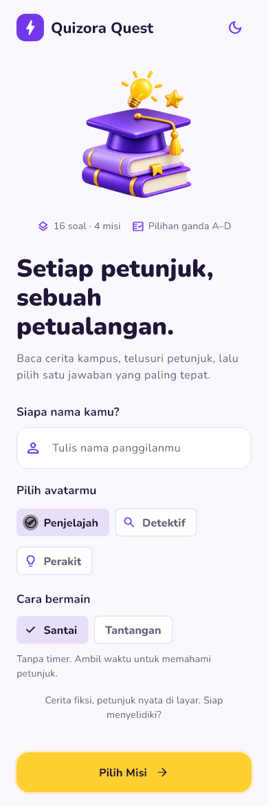
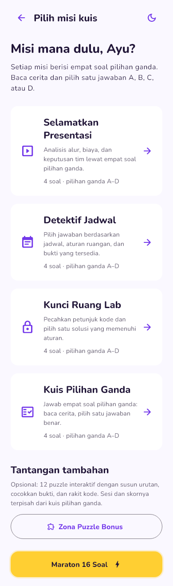
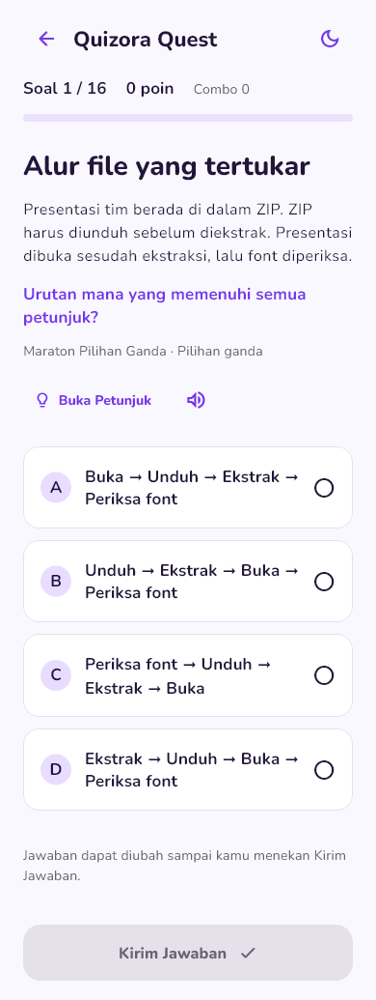
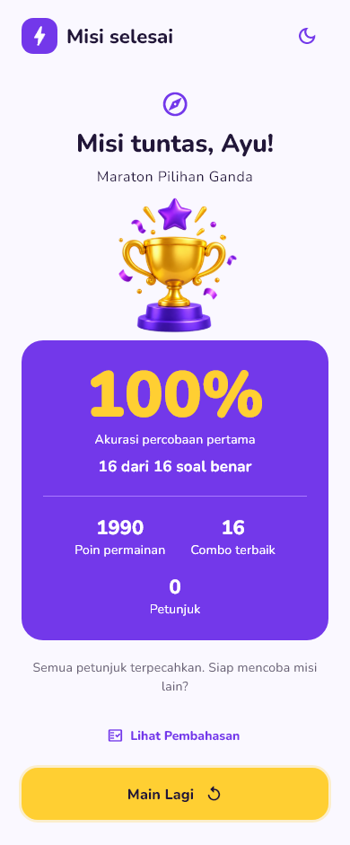
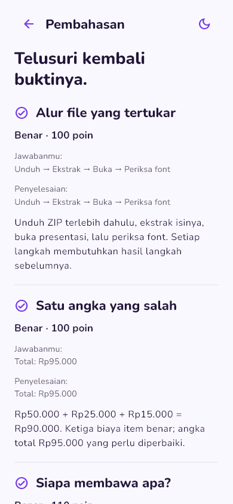
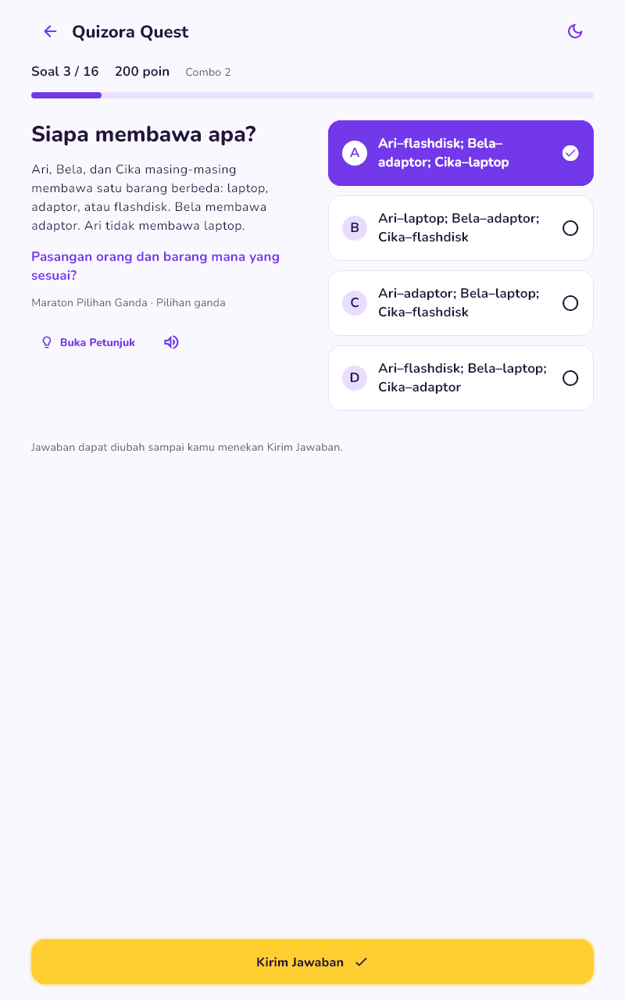
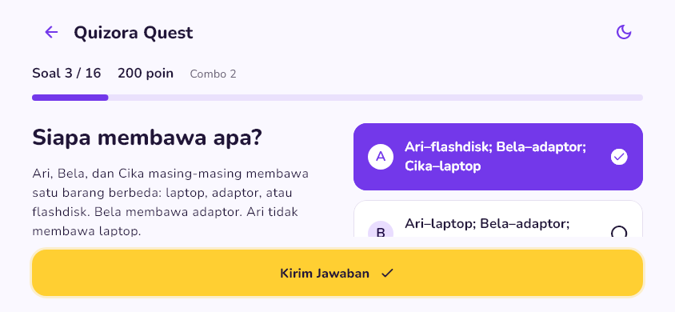
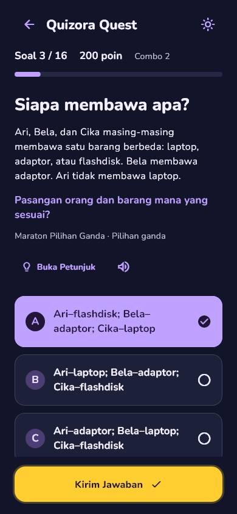

# Quizora Quest

Aplikasi **kuis pilihan ganda** berbasis Flutter untuk UTS Laboratorium Pemrograman Mobile. Pengguna memasukkan nama, menjawab soal, dan melihat skor akhir atas namanya.

Kuis utama berisi **16 soal berbasis cerita kampus**, dibagi menjadi empat misi. Setiap soal memiliki **empat opsi A/B/C/D dan tepat satu jawaban benar**. Keunikan soal berasal dari analisis petunjuk, jadwal, dokumen, dan kode. Puzzle interaktif berada di zona bonus yang terpisah.

## Identitas mahasiswa

| Keterangan | Identitas |
|---|---|
| Nama | **Blessly Silaban** |
| NIM | **241401060** |
| Lab | **PM 5** |
| Mata kuliah | Laboratorium Pemrograman Mobile |

## Informasi aplikasi

| Keterangan | Detail |
|---|---|
| Nama | Quizora Quest |
| Versi | 3.0.0+3 |
| Platform utama | Android |
| Teknologi | Flutter / Dart |
| Data | Lokal/dummy, tanpa database atau akun |
| Bank utama | 16 soal pilihan ganda, 4 misi × 4 soal |
| Fitur tambahan | 12 puzzle bonus dalam sesi terpisah |

Empat misi utama adalah **Selamatkan Presentasi**, **Detektif Jadwal**, **Kunci Ruang Lab**, dan **Kuis Pilihan Ganda**. Pemain dapat memilih satu misi atau menjalankan **Maraton 16 Soal**.

## Fitur dan alur penggunaan

1. Masukkan nama, pilih avatar, lalu pilih mode **Santai** atau **Tantangan**.
2. Pilih misi berisi empat soal atau Maraton berisi seluruh 16 soal.
3. Baca cerita dan petunjuk, lalu pilih **satu** opsi A/B/C/D. Pilihan dapat diganti sebelum dikirim.
4. Tekan **Kirim Jawaban** untuk melihat feedback dan pembahasan. Jawaban yang sudah dikirim dikunci.
5. Selesaikan kuis untuk melihat nama pemain, akurasi, jumlah jawaban benar, poin, combo, dan penggunaan petunjuk.
6. Buka **Lihat Pembahasan**, **Latih yang Belum Tepat**, atau **Main Lagi**.

Fitur tambahan yang tersedia:

- **Dark/Light Mode** yang dapat diganti selama sesi.
- **Mode Tantangan:** timer 90 detik per soal, dengan bonus waktu. Timer dijeda saat meninggalkan halaman kuis atau aplikasi.
- **Petunjuk**, combo, feedback sentuhan, dan suara klik yang dapat dimatikan.
- **Latihan ulang** hanya memuat soal yang salah atau kehabisan waktu, dengan skor sesi latihan tersendiri.
- **Progres tidak hilang saat rotasi, pergantian tema, atau kembali lalu melanjutkan sesi.**
- **Layout responsif:** konten dapat digulir; layar lebar memakai dua kolom.
- **Zona Puzzle Bonus:** 12 tantangan susun urutan, pilih bukti, cocokkan, kategori, pilih kombinasi, rakit kode, dan keputusan skenario. Sesi ini tidak dicampurkan ke 16 soal pilihan ganda utama.

Akurasi dihitung dari jumlah benar dibagi jumlah soal, dibulatkan ke persen. Jawaban benar memberi 100 poin dasar atau 70 dengan petunjuk; combo dan mode Tantangan dapat memberi bonus poin. Karena itu, poin permainan berbeda dari akurasi. Contoh: 16 jawaban benar pada mode Santai tanpa petunjuk menghasilkan **100% dan 1.990 poin**.

## Screenshot setiap halaman

Gambar berikut diekspor dari **widget Flutter versi 3** melalui [generator screenshot](tool/capture_test.dart). Halaman panjang ditampilkan penuh pada lebar ponsel; pembahasan menampilkan bagian awal daftar yang dapat digulir. Nama **Ayu** merupakan data demonstrasi.

| Halaman awal / profil | Pilihan misi | Kuis pilihan ganda |
|---|---|---|
|  |  |  |

| Hasil akhir | Pembahasan |
|---|---|
|  |  |

Contoh tampilan tambahan:

| Tablet | Landscape | Tema gelap |
|---|---|---|
|  |  |  |

[Feedback jawaban](screenshots/03-feedback.png) · [Teks diperbesar](screenshots/09-large-text.png) · [Zona bonus](screenshots/10-bonus.png) · [Timer](screenshots/11-timer.png)

Bukti perangkat Android: [halaman awal APK 3.0.0 di BlueStacks](screenshots/12-android-bluestacks.png). Capture ini berasal dari jendela emulator yang menjalankan APK, berbeda dari capture widget di atas.

## Mockup / prototype

[**Buka file desain dan prototype di Figma**](https://www.figma.com/design/2ojn6WerNvP5gRPTnFNVzK/Untitled?node-id=0-1)

**Status:** file Figma online masih berupa draf versi sebelumnya. Sinkronisasi ke alur pilihan ganda versi 3 belum selesai karena batas kuota Figma MCP Starter. Screenshot di README ini berasal dari source aplikasi terbaru; keduanya tidak diklaim sudah sepenuhnya sama.

## Kredit dan sumber aset

| Aset | Sumber / kredit |
|---|---|
| Font Nunito | **The Nunito Project Authors**, melalui [Google Fonts](https://github.com/google/fonts/tree/main/ofl/nunito). Lisensi [SIL Open Font License 1.1](assets/fonts/OFL.txt). Bobot 400/700/800/900 dibundel lokal. |
| Ikon antarmuka | **Material Icons**, dari Flutter SDK / [Google Material Design Icons](https://github.com/google/material-design-icons). Lisensi Apache 2.0. |
| Ilustrasi edukasi | [education.png](assets/images/education.png), dibuat khusus untuk proyek melalui image generation OpenAI berdasarkan brief desain. |
| Ilustrasi piala | [trophy.png](assets/images/trophy.png), dari ilustrasi proyek yang sama; mempertahankan warna ungu/kuning dan transparansi. |
| Referensi visual awal | Brief dan mockup Gemini yang diberikan pengguna; referensi tersebut tidak disajikan sebagai screenshot hasil aplikasi. |

Seluruh cerita, data, dan petunjuk kuis merupakan contoh fiksi untuk pembelajaran.

## Menjalankan dan membangun

Dikembangkan menggunakan **Flutter 3.35.7 / Dart 3.9.2**. Dari folder proyek pada Windows:

~~~powershell
cd D:\UTSLABPEMMOB
. .\tool\env_d.ps1
flutter pub get
flutter run
~~~

Script lingkungan mengarahkan SDK, cache Gradle/Pub, serta TEMP/TMP ke drive D pada mesin pengembangan ini. Jika memakai mesin berbeda, sesuaikan lokasi SDK/JDK.

~~~powershell
flutter analyze
flutter test
flutter build apk --debug
~~~

APK dihasilkan pada `build/app/outputs/flutter-apk/app-debug.apk`. Untuk pratinjau web, gunakan `flutter run -d chrome`.

## Struktur dan implementasi

~~~text
lib/
  controllers/quiz_controller.dart  # ChangeNotifier: sesi, draft, skor, timer
  data/questions.dart              # 16 soal pilihan ganda utama
  data/bonus_questions.dart        # 12 puzzle bonus terpisah
  models/question.dart             # Model dan evaluasi jawaban
  screens/                         # Welcome, Mission, Quiz, Result, Review
  widgets/                         # Header, tombol, opsi, ilustrasi, layout
  utils/app_theme.dart             # Tema dan font
test/                              # Tes controller, widget, dan skenario kuis
screenshots/                       # Dokumentasi halaman versi terbaru
~~~

`WelcomeScreen` dan `QuizScreen` memakai StatefulWidget; halaman misi, hasil, pembahasan, serta komponen presentasi memakai StatelessWidget sesuai kebutuhan. Satu QuizScreen dipakai untuk seluruh soal. ChangeNotifier dimiliki di atas navigasi sehingga rotasi tidak membuat ulang jawaban.

Sesi disimpan di memori selama aplikasi berjalan. Menutup proses aplikasi atau me-reload web memulai sesi baru. APK debug dipakai untuk demonstrasi/pengujian; signing rilis distribusi resmi belum disiapkan.
