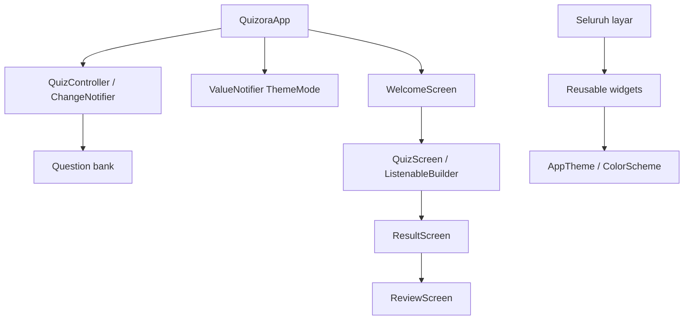

# Arsitektur dan panduan kode

## Struktur

```text
lib/
  main.dart                     # Root: lifecycle state dan tema
  controllers/quiz_controller.dart
  data/questions.dart           # Bank soal lokal
  models/question.dart          # Bentuk data soal
  screens/
    welcome_screen.dart         # Stateful: form dan nama
    quiz_screen.dart            # Stateful: aksi dan navigasi
    result_screen.dart          # Stateless: hasil
    review_screen.dart          # Stateless: pembahasan
  widgets/
    app_header.dart
    custom_primary_button.dart
    option_card.dart
    quiz_artwork.dart
    responsive_page.dart
  utils/app_theme.dart
assets/
  fonts/                        # Nunito dan lisensi
  images/                       # Ilustrasi PNG transparan
test/                           # Unit dan widget tests
tool/                           # Capture visual yang dapat diulang
docs/                           # Bukti, panduan, dan screenshot
```

## Pemisahan tanggung jawab

Model menjelaskan bentuk data; data menyediakan soal; controller mengatur aturan sesi; layar mengatur alur presentasi; widget memuat komponen berulang; utils memuat tema. Struktur ini menggunakan pemisahan lapisan sederhana yang sesuai skala aplikasi, tanpa repository/server tambahan.



## Keputusan state management

QuizController dibuat sekali pada State root app dan dibuang melalui dispose. Route menerima referensi yang sama. ListenableBuilder pada kuis merespons perubahan pilihan dan indeks. Rotasi hanya memicu perubahan constraint, bukan memanggil start. Tema disimpan pada ValueNotifier terpisah agar perubahan tema tidak membuat controller baru.

Welcome menggunakan TextEditingController dan Form. Listener sesi membersihkan nama saat reset dan memperbarui tindakan lanjut sesi. Listener serta TextEditingController dilepas ketika Welcome dibuang.

## Navigasi

- Welcome → Quiz memakai push.
- Quiz → Result memakai pushReplacement sehingga kuis selesai tidak dibuka ulang dari hasil.
- Result → Review memakai push.
- Main Lagi memakai reset dan popUntil route pertama.
- Tombol/system back pada kuis kembali ke soal sebelumnya; dari soal pertama kembali ke Welcome, dengan sesi masih dapat dilanjutkan.

## Responsivitas

ResponsivePage memusatkan lebar maksimum 1040 logical pixel, menggunakan SafeArea, dan menyediakan konten bergulir. Padding halaman 24 untuk lebar layar di bawah 600, selebihnya 40. Welcome dan kuis memakai dua kolom pada lebar konten minimal 720; selebihnya satu kolom. Halaman hasil dibatasi 640 dan pembahasan 800. Nilai batas dan spacing adalah token desain; ukuran tombol tidak dikunci ke lebar perangkat tertentu.

Footer kuis tetap mudah dijangkau sementara pertanyaan/opsi bisa digulir. Label tombol memakai Flexible; pertanyaan dan nama boleh membungkus. Sistem tidak mengunci orientasi Android.

## Menambah atau mengubah soal

Edit `lib/data/questions.dart`, isi id unik, kategori, pertanyaan, empat opsi, correctIndex 0–3, dan penjelasan. Jumlah soal, progress, dan skor menyesuaikan otomatis. Uji controller memeriksa keunikan id dan opsi. Ganti label topik di QuizScreen jika keseluruhan bank berubah.

## Penyimpanan

State hanya di memori. Untuk kebutuhan pemulihan process death di masa depan, tambahkan penyimpanan sesi dan versi bank soal; kebutuhan itu tidak sama dengan menjaga pilihan saat rotasi. Saat ini tidak ada kredensial atau koneksi backend.
