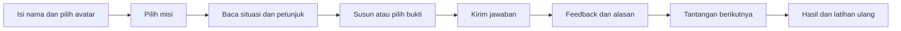

# Quizora Quest — rancangan konsep v2

Status: konsep disetujui pengguna melalui “coba kerjakan” dan diterapkan pada source v2. Tanggal: 7 Oktober 2026. Bukti build dan pengujian dicatat di `testing-v2.md`.

## Gagasan utama

Quizora menjadi permainan misi singkat. Pemain membaca situasi, memanipulasi bukti, mengirim jawaban, mendapat penjelasan, lalu membuka tantangan berikutnya. Poin, combo dan selebrasi memberi ritme seperti kuis permainan. Identitas ungu/kuning, Nunito, Material dan ilustrasi 3D tetap menjadi dasar desain.

Tema yang diterapkan: **logika dan misteri kehidupan kampus**, mengikuti konsep yang diminta untuk dikerjakan. Semua tokoh, jadwal, angka dan kejadian pada contoh adalah fiksi yang sengaja dibuat untuk puzzle; jawabannya dapat ditentukan dari informasi di layar.

## Pengalaman pemain

Beranda menampilkan misi dengan judul dan tujuan yang nyata: “Selamatkan Presentasi”, “Detektif Jadwal”, dan “Kunci Ruang Lab”. Masing-masing berisi empat tantangan, dengan empat bentuk interaksi berbeda. Dua belas contoh lengkap ada dalam `question-system-v2.md`.

Layar permainan memiliki progress misi, area cerita/bukti, instruksi tindakan yang spesifik, serta tombol Kirim Jawaban. Sesudah submit, jawaban dikunci dan feedback menunjukkan jawaban pemain, penyelesaian yang benar, alasan, serta perubahan poin. Pengguna memilih sendiri kapan lanjut sehingga pembahasan sempat dibaca.

Hasil menampilkan akurasi, poin permainan, combo terbaik dan tipe tantangan yang perlu dilatih. Tombol “Latih yang belum tepat” hanya memasukkan soal yang benar-benar salah pada sesi itu. Peringkat online baru dapat ditampilkan bila tersedia peserta dan backend yang nyata.

## Rasa permainan

- Avatar sederhana, pemilihan misi dan progress penyelesaian.
- Combo untuk beberapa jawaban benar tanpa bantuan secara berurutan.
- Petunjuk: menyorot satu aturan relevan atau menunjukkan satu pasangan/posisi yang benar.
- Feedback singkat, animasi centang, haptic dan selebrasi pada penyelesaian misi; suara dapat dimatikan.
- Mode Santai sebagai default, tanpa batas waktu. Mode Tantangan menggunakan timer yang dapat dijeda ketika aplikasi tidak aktif.
- Kesalahan direspons dengan alasan yang bisa dipelajari, bukan hanya layar merah.

## Sistem soal yang membedakan

Isi pertanyaan dan cara menjawab sama-sama beragam. Dalam satu misi pemain dapat mengurutkan kartu, mengetuk kesalahan di dokumen, menyambungkan pasangan dan merakit kode. Semua soal menyertakan aturan yang cukup untuk menghasilkan jawaban yang dapat dinilai secara konsisten.

Drag-and-drop selalu mempunyai alternatif ketuk/pilih atau tombol naik/turun. Pilihan pada gambar juga mempunyai daftar bagian berlabel. Dengan demikian kontrol tetap bisa digunakan di layar kecil, saat rotasi, dan melalui aksesibilitas.

## Skor usulan

**Akurasi dan poin permainan ditampilkan terpisah.** Akurasi adalah persentase soal yang diselesaikan dengan benar pada percobaan pertama. Poin dasar 100 per jawaban benar; bantuan mengurangi poin menjadi 70 tetapi tidak mengubah benar/salah. Combo memberi bonus 10 pada jawaban benar ketiga berturut-turut, 20 pada keempat, dan 30 pada kelima dan berikutnya. Salah atau penggunaan bantuan memutus combo. Jawaban terkirim tidak dapat direvisi untuk mengejar bonus.

Mode Santai tanpa bonus kecepatan. Pada usulan Mode Tantangan, jawaban benar mendapatkan bonus paling banyak 20 berdasarkan sisa waktu. Timer dan animasi tidak boleh menghalangi pembacaan instruksi atau feedback. Soal yang terlewat akibat waktu habis ditandai “waktu habis”, berbeda dari jawaban salah.

## Konsekuensi implementasi Flutter

Model v1 memiliki empat opsi dan satu indeks kunci. V2 memerlukan tipe soal, payload per tipe, struktur jawaban, evaluator per tipe, dan status draft/submitted. Controller tetap dibuat di root agar pilihan, susunan, pasangan, petunjuk dan timer tidak hilang saat rotasi. Untuk mencegah poin ganda, penilaian submit bersifat idempotent.

Implementasi v2 mencakup bank puzzle, renderer per tipe, submit/feedback, misi, hasil dan latihan ulang. Multiplayer live, kode room, leaderboard online dan editor pembuat soal merupakan perluasan yang membutuhkan desain server tersendiri. Level fiksi tidak memakai peserta atau peringkat rekaan.

## Kriteria penerimaan usulan

- Tiga misi, masing-masing empat puzzle dengan bentuk interaksi bervariasi.
- Setiap puzzle mempunyai satu solusi atau himpunan solusi yang eksplisit, serta penjelasan.
- Soal dapat diselesaikan dari informasi yang diberikan, tanpa pengetahuan umum acak.
- Draft jawaban tetap identik setelah rotasi dan perubahan tema.
- Kirim Jawaban dinonaktifkan sampai struktur jawaban lengkap.
- Feedback tidak bergantung pada warna saja; teks dan ikon menyatakan status.
- Submit ulang, rotasi atau kembali ke feedback tidak menambahkan poin lagi.
- Poin bantuan, combo, timeout dan latihan ulang mempunyai pengujian yang terpisah.
- Implementasi dan build tetap berjalan menggunakan konfigurasi drive D.

## Referensi

Dokumentasi resmi [tipe pertanyaan Wayground](https://help.wayground.com/support/solutions/articles/158000411419-question-types-explained) menjelaskan matching, reorder, categorize, hotspot dan bentuk lain. [Mode sesi Wayground](https://help.wayground.com/support/solutions/articles/158000404918-live-session-modes-on-wayground) menjadi referensi untuk perpaduan kuis dan permainan. Nama misi, puzzle, aturan skor dan alur Quizora Quest di dokumen ini merupakan usulan untuk proyek ini.
