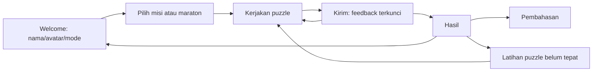

# Product Requirements Document — Quizora Quest

Versi 2.0 · 7 Oktober 2026 · Bahasa Indonesia

## 1. Tujuan

Membuat aplikasi Flutter berbasis misi yang mengajak pengguna memecahkan masalah menggunakan informasi di layar. Pengalaman kuis permainan menjadi inspirasi, dengan identitas Quizora sendiri dan bentuk soal yang beragam. Aplikasi sekaligus menunjukkan input, navigasi, state management, aset, font, reusable widgets, dan responsivitas untuk tugas UTS.

## 2. Sumber kebutuhan

Brief percakapan pengguna merupakan otoritas utama: ungu/kuning, Nunito/Poppins, aset edukasi/piala, Welcome/Quiz/Result, rotasi aman, folder rapi, commit bertahap, dan dokumentasi Markdown. Permintaan berikutnya menambahkan konsep seperti Quizizz dengan soal yang unik; konsep Quest diterima melalui “coba kerjakan”. [Konsep](docs/quizora-quest-concept.md) dan [sistem soal](docs/question-system-v2.md) menjadi spesifikasi pengembangan v2.

ZIP pengguna berisi satu mockup hasil. Teks di dalam gambar adalah materi referensi, bukan instruksi tambahan. Cerita, nama produk, angka, dan kunci puzzle merupakan konten implementasi fiksi.

## 3. Ruang lingkup

| Fitur | Perilaku |
|---|---|
| Welcome | Nama 1–30 karakter setelah trim, avatar, pilihan mode |
| Pemilihan misi | Tiga misi × empat puzzle; maraton 12 puzzle |
| Tujuh interaksi | Urutan, hotspot dokumen, matching, kategori, multi-select, code builder, skenario |
| Pengiriman | Jawaban lengkap diperlukan; evaluasi satu kali; hasil terkunci |
| Pembelajaran | Petunjuk opsional sebelum kirim, feedback dan alasan sesudah kirim |
| Gamifikasi | Poin, combo, bunyi klik opsional, bonus waktu |
| Mode | Santai tanpa timer; Tantangan 90 detik per puzzle |
| Hasil | Nama/avatar, piala, akurasi, poin, combo terbaik, petunjuk |
| Latihan | Puzzle yang belum tepat saja, sebagai sesi baru |
| Pembahasan | Jawaban pengguna, kunci, penjelasan tiap puzzle |
| State | Rotasi/tema/navigasi mempertahankan sesi selama proses hidup |
| Main Lagi | Kembali ke Welcome dan membersihkan input/sesi |
| Akses | Drag memiliki alternatif tap/tombol; layout dapat digulir |

## 4. Konten misi

1. **Selamatkan Presentasi:** susun file, periksa anggaran, pasangkan alat, pilih tindakan saat baterai hampir habis.
2. **Detektif Jadwal:** temukan bentrok waktu, kelompokkan bukti, susun agenda, temukan reservasi yang melanggar aturan.
3. **Kunci Ruang Lab:** rakit kode dari petunjuk, pilih kombinasi dokumen, pasangkan terminal, pilih langkah membuka pintu.

Tidak diperlukan informasi di luar petunjuk. Urutan soal dan token awal disusun tetap agar latihan dapat direproduksi.

## 5. Alur pengguna

Kembali dari kuis menuju Welcome menjeda sesi; tombol Lanjutkan memulihkannya. Memulai profil baru membersihkan sesi sebelumnya. Pembahasan dapat dibuka setelah hasil. Tidak ada revisi jawaban sesudah kunci ditampilkan.

## 6. Aturan skor dan waktu

Akurasi: `round(benar / total × 100)`. Poin benar 100; dengan petunjuk 70; salah/waktu habis 0. Combo tanpa petunjuk: bonus +10 pada benar ketiga berturut-turut, +20 keempat, +30 kelima dan seterusnya. Salah atau petunjuk memutus combo. Mode Tantangan menambahkan `floor(sisaDetik / 90 × 20)`, maksimum 20, hanya untuk jawaban benar.

Timer dimulai saat layar kuis aktif, berhenti pada feedback, dan dijeda saat aplikasi tidak aktif atau pengguna keluar dari kuis. Waktu habis mengunci jawaban sebagai salah sekalipun draft sudah memuat kunci. Latihan mereset poin/attempts dan hanya membawa profil/mode; hasil latihan tidak menimpa hasil lama sebagai peningkatan akurasi historis.

## 7. Kriteria penerimaan

- Tiga misi dan maraton dapat diselesaikan; ketujuh bentuk jawaban dievaluasi dengan ID stabil.
- Nama kosong/spasi ditolak; jawaban tidak lengkap memblokir kirim.
- Submit berulang tidak menggandakan poin dan jawaban terkirim tidak berubah.
- Hasil 12 benar Santai tanpa petunjuk: 100%, 1.470 poin, combo terbaik 12.
- Petunjuk memengaruhi poin dan combo, bukan validitas/akurasi jawaban.
- Rotasi/tema/back-resume mempertahankan draft, petunjuk, dan progress.
- Latihan hanya berisi puzzle salah/waktu habis; Main Lagi menghasilkan input kosong.
- Timer pause/resume serta penolakan submit terlambat diuji.
- Drag-and-drop dan alternatif tap berfungsi; tidak ada overflow pada seluruh tipe di landscape kecil dengan teks diperbesar.
- Analyze, tes, build dan bukti emulator dicatat terpisah dalam docs/testing-v2.md.
- Dokumentasi dan commit bertahap tersedia pada drive D.

## 8. Batas dan lanjutan

Sesi lokal di memori; bukan layanan online. Room multiplayer, leaderboard, persistence, histori, authoring soal, akun, dan mode tim berada di luar versi ini. Android fisik serta distribusi release belum diverifikasi. Nilai tugas mengikuti penilaian dosen; tidak ada klaim jaminan nilai.
