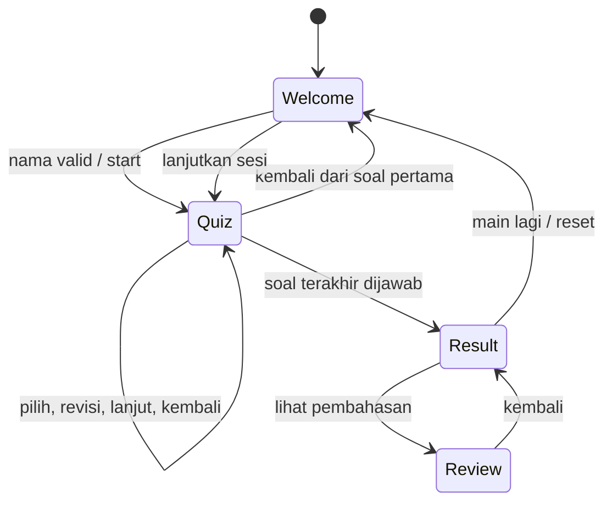

# Software Requirements Specification — Quizora

Versi 1.0 · 6 Oktober 2026

## 1. Gambaran sistem

Aplikasi Flutter Material 3 berjalan secara lokal. Input berupa nama dan pilihan jawaban; output berupa progress, skor, serta pembahasan. Semua aset dan font dibundel. Tidak diperlukan koneksi internet untuk menjalankan kuis Android setelah instalasi.

## 2. Lingkungan

- Implementasi: Flutter 3.35.7 dan Dart 3.9.2 yang tersedia pada mesin pengembangan.
- Target: Android, dengan web untuk pratinjau.
- Dependensi runtime: Flutter SDK saja.
- Pengembangan: flutter_test dan flutter_lints, dikunci dalam pubspec.lock.
- Bahasa antarmuka: Indonesia. Font: Nunito dengan lisensi SIL OFL.
- Konfigurasi SDK Android lokal tidak dimasukkan ke Git.

## 3. Kebutuhan fungsional

| ID | Kebutuhan | Implementasi / bukti |
|---|---|---|
| FR-01 | Sistem menampilkan Welcome dengan ilustrasi edukasi | WelcomeScreen, QuizArtwork |
| FR-02 | Sistem menerima dan trim nama 1–30 karakter | TextFormField, QuizController.start |
| FR-03 | Input tidak valid menghasilkan pesan dan tetap pada Welcome | validator, widget test |
| FR-04 | Mulai Kuis menginisialisasi seluruh state | start mengatur nama, indeks, answers |
| FR-05 | Setiap soal memiliki empat opsi dan kunci valid | Question, validasi controller |
| FR-06 | Sistem hanya menyimpan satu pilihan per soal | slot answers[index] |
| FR-07 | Pilihan dapat diganti sebelum selesai | select menimpa slot yang sama |
| FR-08 | Sistem memblokir lanjut jika belum menjawab | tombol null, guard next |
| FR-09 | Sistem menampilkan posisi dan progress jawaban | index+1, answered/total |
| FR-10 | Kembali membuka soal sebelumnya beserta pilihannya | previous, PopScope |
| FR-11 | Kembali dari soal pertama membuka Welcome | Navigator.pop |
| FR-12 | Sesi aktif dapat dilanjutkan dari Welcome | tombol Lanjutkan kuis sebelumnya |
| FR-13 | Soal terakhir yang dijawab menyelesaikan sesi | next mengatur completed |
| FR-14 | Sistem menghitung skor dari kunci, tanpa double count | correct dan score |
| FR-15 | Sistem menampilkan nama, piala, skor, benar/salah | ResultScreen |
| FR-16 | Main Lagi membersihkan state dan input nama | reset, listener Welcome |
| FR-17 | Pembahasan memuat jawaban, kunci, penjelasan | ReviewScreen |
| FR-18 | Sistem menyediakan tema terang dan gelap | ThemeMode, AppTheme |
| FR-19 | Perubahan ukuran/tema tidak membuat sesi baru | controller pada root app |

## 4. Kebutuhan nonfungsional

| ID | Kebutuhan | Kriteria verifikasi |
|---|---|---|
| NFR-01 | Responsif pada portrait dan landscape | Widget test ukuran kecil dan rotasi |
| NFR-02 | Mendukung pembesaran teks | Landscape 568×320, skala teks 1.5 |
| NFR-03 | Area sentuh utama memadai | Tombol min tinggi 58, ikon min 48 |
| NFR-04 | Konten aman dari inset OS/keyboard | SafeArea dan Scaffold resize |
| NFR-05 | Font/aset tersedia lokal | deklarasi pubspec dan aset bundel |
| NFR-06 | Komponen UI dapat digunakan kembali | tombol, opsi, header, halaman, artwork |
| NFR-07 | Pemisahan tanggung jawab | models, data, controllers, screens, widgets, utils |
| NFR-08 | State tidak hilang ketika rotasi | tes pilihan sebelum/sesudah perubahan viewport |
| NFR-09 | Kontrol memiliki informasi semantik | label/selected opsi, progress, skor, tooltip |
| NFR-10 | Kode dapat dianalisis dan diuji | analyze dan flutter test |
| NFR-11 | Dokumentasi dapat ditelusuri | PRD, SRS, arsitektur, pengujian, todo |

NFR-08 berlaku untuk perubahan konfigurasi saat proses hidup, bukan process death. Pemulihan setelah OS menghentikan proses belum diimplementasikan.

## 5. Struktur data

### Question

| Field | Tipe | Aturan |
|---|---|---|
| id | String | Unik dalam bank soal |
| category | String | Label kategori untuk orientasi pengguna |
| text | String | Pertanyaan lengkap |
| options | List<String> | Tepat empat pilihan berbeda |
| correctIndex | int | Indeks 0–3 |
| explanation | String | Penjelasan kunci |

### QuizController

Nama, indeks aktif, daftar pilihan nullable, dan completed merupakan state mutabel. Daftar pertanyaan dan getter answers diekspos sebagai list yang tidak dapat dimutasi. Skor dan progress dihitung dari state, bukan disimpan sebagai penghitung tambahan.

## 6. Mesin state

## 7. Use case

### UC-01 — Menyelesaikan kuis

Prasyarat: aplikasi terbuka. Pengguna mengisi nama, memulai kuis, memilih jawaban pada setiap soal, dan melihat hasil. Alternatif: nama kosong ditolak; jawaban kosong memblokir lanjut; pengguna dapat kembali untuk revisi. Pascakondisi: completed benar, seluruh jawaban tersimpan, skor tersedia.

### UC-02 — Memutar perangkat

Prasyarat: sesi aktif dan minimal satu pilihan sudah dibuat. Perangkat berganti orientasi. Flutter membangun layout sesuai lebar baru dengan controller yang sama. Pascakondisi: nama, indeks, dan pilihan identik.

### UC-03 — Mengulang

Prasyarat: halaman hasil. Pengguna menekan Main Lagi. Controller direset dan stack route kembali ke root. Pascakondisi: input nama kosong, seluruh jawaban null, indeks nol.

## 8. Batasan dan penanganan error

- Controller menolak bank soal kosong atau struktur opsi/kunci tidak valid.
- Pemilihan indeks opsi di luar jangkauan ditolak.
- Operasi pemilihan setelah selesai diabaikan; next tidak menyelesaikan dua kali.
- Tidak ada hasil kuis parsial; pengguna harus menjawab seluruh soal.
- Nama hanya lokal dan tidak dikirim ke server.
- Aplikasi tidak menyimpan identitas atau histori skor setelah proses berakhir.

## 9. Matriks ketertelusuran

| Tujuan PRD | Requirement | Pengujian |
|---|---|---|
| Input valid | FR-02–04 | controller names, full flow |
| Kuis lengkap | FR-05–10 | answer revision, full flow |
| Skor personal | FR-13–15 | mixed, zero/perfect, full flow |
| Main lagi | FR-16 | reset dan replay |
| Pembahasan | FR-17 | full flow review |
| Rotasi dan tema | FR-18–19, NFR-01/02/08 | rotation/theme, enlarged text |
