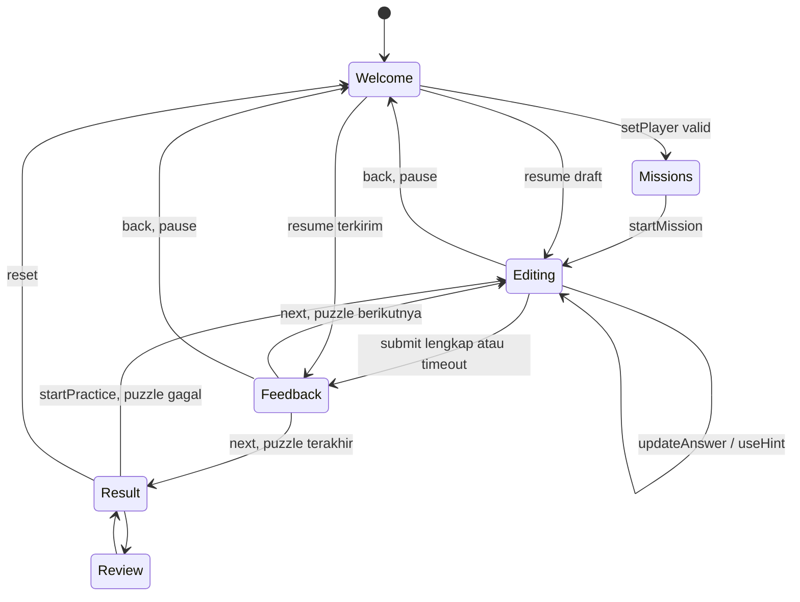

# Software Requirements Specification — Quizora Quest

Versi 2.0 · 7 Oktober 2026

## 1. Sistem dan lingkungan

Flutter Material 3 offline dengan Flutter 3.35.7 / Dart 3.9.2. Android target utama, web pratinjau. Dependensi runtime hanya Flutter SDK; Nunito dan dua ilustrasi PNG dibundel. Seluruh proyek, cache pengembangan, TEMP/TMP, JDK dan AVD diarahkan ke D oleh tool/env_d.ps1. Bahasa antarmuka Indonesia.

## 2. Kebutuhan fungsional

| ID | Kebutuhan | Implementasi / verifikasi |
|---|---|---|
| FR-01 | Validasi nama trim 1–30 karakter dan avatar sah | WelcomeScreen, setPlayer, tes profil |
| FR-02 | Mode Santai/Tantangan dan pemilihan misi | MissionScreen, startMission, tes filter |
| FR-03 | Tujuh bentuk soal dengan ID stabil | QuestionType, PuzzleInteractor, tes evaluator |
| FR-04 | Kunci dan bank divalidasi saat controller dibuat | QuizController constructor |
| FR-05 | Draft dapat diubah sampai dikirim | updateAnswer, tes lock |
| FR-06 | Jawaban lengkap diperlukan sebelum kirim | Question.isComplete, canSubmit |
| FR-07 | Submit sekali menghasilkan immutable PuzzleAttempt | submit, tes double count |
| FR-08 | Feedback memuat jawaban, kunci, alasan, poin | PuzzleFeedback |
| FR-09 | Petunjuk sekali per puzzle dan hanya sebelum submit | useHint, tes hint/combo |
| FR-10 | Akurasi dan poin memiliki aturan terpisah | score, points, tes 1470 |
| FR-11 | Combo, bonus waktu, dan timeout mengikuti PRD | submit, checkClock, fake clock tests |
| FR-12 | Timer dijeda oleh navigasi/lifecycle | setNavigationPaused, setLifecyclePaused |
| FR-13 | Draft/progress tidak hilang ketika rotasi/tema | controller root, widget/native evidence |
| FR-14 | Back ke Welcome dapat dilanjutkan | hasSession, tombol Lanjutkan |
| FR-15 | Terakhir sesudah submit menuju hasil | next, ResultScreen |
| FR-16 | Pembahasan menampilkan seluruh attempt | ReviewScreen |
| FR-17 | Latihan hanya memuat puzzle belum tepat | startPractice, unit/widget tests |
| FR-18 | Main Lagi membersihkan state dan nama input | reset, Welcome listener, tes replay |
| FR-19 | Tema dan bunyi dapat diubah | ThemeMode, toggleSound |
| FR-20 | Semua operasi drag memiliki alternatif tap | PuzzleInteractor, tes UI lengkap |

## 3. Kebutuhan nonfungsional

| ID | Kriteria | Bukti |
|---|---|---|
| NFR-01 | Portrait/landscape tanpa orientasi dikunci | Widget tests, emulator |
| NFR-02 | Seluruh tipe aman pada 568×320 skala teks 1.5 | Widget renderer test |
| NFR-03 | Konten bergulir, SafeArea, keyboard resize | ResponsivePage, native capture |
| NFR-04 | Tidak membuat controller baru ketika rebuild/rotasi | State root dan lifecycle observer |
| NFR-05 | Sesi Android tidak membutuhkan jaringan | Aset/font/bank lokal, SDK saja |
| NFR-06 | Reusable component dan lapisan terpisah | widgets/models/data/controllers/screens/utils |
| NFR-07 | Pilihan memiliki label/selected dan feedback tidak hanya warna | Semantics, ikon, teks |
| NFR-08 | Animasi mengikuti reduced motion | AnimatedSwitcher duration mengikuti MediaQuery |
| NFR-09 | Sumber dan keputusan dapat ditelusuri | PRODUCT, DESIGN, PRD/SRS, docs dan Git |
| NFR-10 | Analisis statis dan pengujian lulus | docs/testing-v2.md |

State dijamin selama proses Flutter hidup. Pemulihan setelah process death/reload belum diimplementasikan. Kualitas aksesibilitas di TalkBack fisik belum diuji.

## 4. Struktur data

| Model | Field penting | Aturan |
|---|---|---|
| Mission | id, title, description | missionId mengelompokkan bank |
| PuzzleItem | id, label, detail | ID unik per items/targets |
| Question | id, missionId, type, title, context, instruction, items, targets, answerKey, hint, explanation | Kunci lengkap dan valid untuk tipe |
| PuzzleAttempt | answer, correct, usedHint, timedOut, points, comboBonus, timeBonus | Immutable, satu per ID per sesi |

Bentuk jawaban:
- sequence: daftar item ID dalam urutan.
- hotspot/scenario: satu item ID.
- matching/categorize: target ID per posisi item; matching mensyaratkan pasangan unik.
- multiSelect: himpunan item ID, urutan tidak memengaruhi evaluasi.
- codeBuilder: daftar token ID per slot, tanpa token ganda.

Urutan tampilan dapat berubah tanpa merusak kunci karena penilaian memakai ID. Seluruh draft dan attempt diekspos sebagai koleksi yang tidak dapat dimutasi dari luar.

## 5. Mesin state

Clock aktif hanya jika mode Tantangan, sesi aktif, belum submit, navigasi aktif, dan lifecycle aktif. Timer periodik memeriksa deadline; submit juga memeriksa deadline agar input tepat sesudah batas tidak memperoleh poin.

## 6. Use case dan error

UC-01: profil → misi → jawab/kirim/feedback → hasil → pembahasan/reset.
UC-02: rotasi dengan kode parsial → layout berubah → token/petunjuk/indeks tetap.
UC-03: hasil dengan puzzle salah → latihan hanya puzzle itu → hasil sesi latihan terpisah.
UC-04: background/back saat Tantangan → clock pause → resume dengan sisa waktu sama.

Nama, avatar, ID, panjang draft, missionId, bank kosong/duplikat/kunci invalid ditolak. Update sesudah submit diabaikan, submit duplikat gagal, dan next tanpa submit tidak melanjutkan. Tidak ada hasil parsial; tiap puzzle harus dikirim atau timeout.

## 7. Ketertelusuran

| Tujuan PRD | Requirement | Pengujian |
|---|---|---|
| Puzzle beragam | FR-03–06, FR-20 | 7 evaluator, full UI 12, drag token |
| Skor adil | FR-07–11 | immutability, 1470, hints/combo, clock |
| Latihan dan reset | FR-15–18 | unit + widget practice/replay |
| Sesi aman | FR-12–14, NFR-01–04 | rotation/theme/back-resume, lifecycle clock |
| Tampilan responsif | NFR-01–03/07/08 | seluruh tipe landscape/text scale dan capture native |
